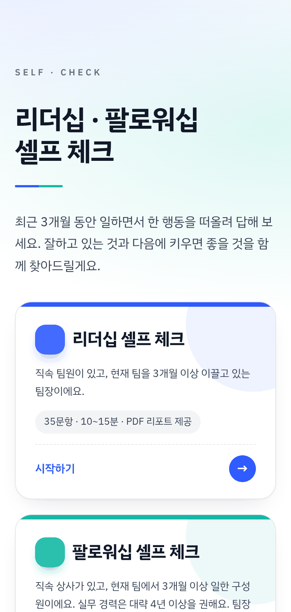
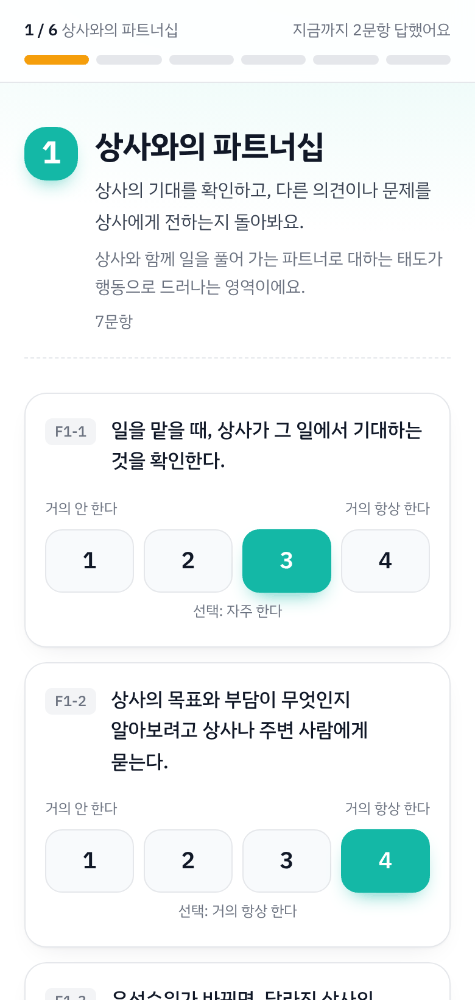
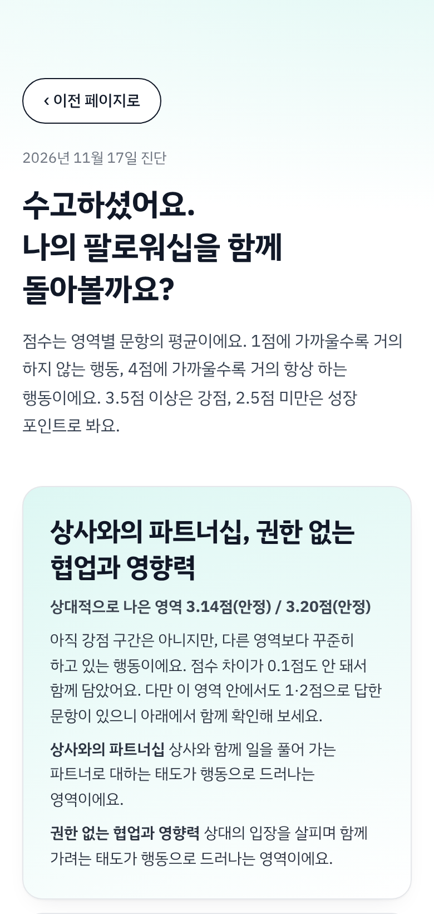
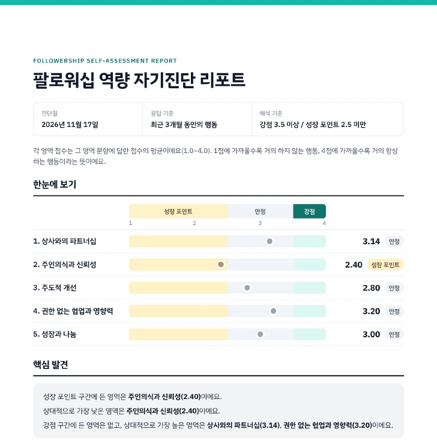

# 셀프 체크 · 리더십과 팔로워십

최근 3개월 동안 내가 한 행동을 떠올려 답하면, **잘하고 있는 것**과 **다음에 키우면 좋을 것**을 찾아 주는 자기 성찰용 셀프 체크예요. 팀을 이끄는 사람을 위한 **리더십 셀프 체크**와, 상사가 있는 구성원을 위한 **팔로워십 셀프 체크** 두 가지가 있어요.

### 👉 [바로 해 보기](https://jjeonglee.github.io/self-check/)

로그인도 가입도 필요 없고, 이름이나 연락처 같은 개인정보도 묻지 않아요.

<p align="center">
  
  
  
  
</p>
<p align="center"><sub>왼쪽부터 시작 화면 · 문항 화면 · 결과 화면 · PDF 리포트 (화면은 예시 응답으로 만든 것이에요)</sub></p>

## 두 가지 셀프 체크

| | 리더십 셀프 체크 | 팔로워십 셀프 체크 |
|---|---|---|
| 주소 | [`/leader.html`](https://jjeonglee.github.io/self-check/leader.html) | [`/follower.html`](https://jjeonglee.github.io/self-check/follower.html) |
| 대상 | 직속 팀원이 있고, 현재 팀을 3개월 이상 이끌고 있는 팀장 | 직속 상사가 있고, 현재 팀에서 3개월 이상 일한 구성원(실무 경력 대략 4년 이상을 권해요). 팀장·임원도 윗사람에게는 팔로워예요 |
| 문항 수 | 35문항, 6개 영역 | 31문항, 6개 영역 |
| 영역 | 방향 설정과 의사결정 · 성과 관리 · 코칭·육성 · 위임과 역할 전환 · 팀 문화와 협업 · 자기관리 점검 | 상사와의 파트너십 · 주인의식과 신뢰성 · 주도적 개선 · 권한 없는 협업과 영향력 · 성장과 나눔 · 자기관리 점검 |
| 소요 시간 | 10~15분 | 10~15분 |

하나만 해도 되고, 팀장이라면 두 가지를 모두 해 볼 수도 있어요. 한쪽을 하다가 다른 쪽이 궁금해지면 결과 화면의 안내 카드에서 바로 이어서 할 수 있고, 두 진단의 응답은 따로 저장돼요.

## 어떻게 답하나요

- 각 문항은 **최근 3개월 동안 그 행동을 얼마나 자주 했는지** 4단계(거의 안 한다 ~ 거의 항상 한다)로 답해요. 되고 싶은 모습이 아니라 실제로 해 온 모습이 기준이에요.
- 일부 문항에는 "해당 상황 없음"이 있어요(리더십 13문항, 팔로워십 2문항).
- 답할 때마다 자동으로 저장돼서, 중간에 멈춰도 같은 기기에서 이어서 할 수 있어요.

## 결과에서 볼 수 있는 것

- **영역별 점수와 구간**: 영역 안 문항의 평균으로 강점(3.5 이상) · 안정 · 성장 포인트(2.5 미만)를 나눠 보여 줘요.
- **가장 단단한 영역과 다음 성장 포인트**, 그리고 1·2점으로 답한 문항 모음.
- **자기관리 점검**: 지금 나에게 얼마나 여유가 있는지 보고, 점수가 낮으면 스킬 교육보다 회복이 먼저일 수 있다고 안내하며 추천 순서에도 반영해요.
- **추천 교육**: 낮게 답한 문항을 기준으로 최대 3개 주제를 학습 순서대로 제안해요. 첫 주제는 온라인(휴넷)과 집합(KPC) 교육을 함께, 나머지는 온라인 교육 하나씩 보여 줘요. 한 번에 하나씩 듣고 4~6주 실천한 뒤 다음으로 넘어가도록 안내해요.
- **문항별 근거와 참고 자료**: 화면 아래 "이 진단지의 근거"에서 볼 수 있어요.
- **PDF 리포트**: 결과를 A4 리포트로 저장해요(요약, 영역별 상세, 추천 교육 순서, 활용 가이드, 근거와 참고 자료). PDF는 이 기기 안에서 만들어져요. 샘플은 [`docs/sample-report-follower.pdf`](docs/sample-report-follower.pdf)에서 볼 수 있어요.

## 설계 근거와 한계

문항 문장은 리더십·조직심리 연구와 대표적인 실무 모델을 바탕으로 이 진단을 위해 새로 썼고, 자료의 측정 문항을 그대로 옮긴 것은 아니에요.

| | 참고 자료 | 바탕이 된 자료의 예 |
|---|---|---|
| 리더십 | 29건 | Google re:Work(Project Oxygen), Edmondson(심리적 안전감), Locke & Latham(목표 설정), Goleman, 리더십 파이프라인 등 |
| 팔로워십 | 28건 | Kelley, Chaleff, Uhl-Bien(팔로워십 연구), Morrison(발언), Parker 외(주도적 행동), Yukl 외(영향력 전술) 등 |

참고 자료 목록에는 가능한 한 실제로 확인한 범위(원문, 초록, 목차 등)를 적어 두었어요.

**알아 두세요**

- **통계적 타당화를 거친 표준화 검사가 아니에요.** 스스로를 돌아보고 성장할 영역을 찾는 출발점으로 써 주세요. 다른 사람을 평가하거나 선발·평가에 쓰는 용도로 만든 것이 아니에요.
- 구간 기준(3.5 이상, 2.5 미만)은 이 진단의 해석 기준이에요. 어떤 집단과 비교한 값이 아니에요.
- 일부 문항은 연구에서 직접 검증한 행동이 아니라 연구를 바탕으로 해석한 행동이고, 이런 경우 근거 표에 그렇게 적어 두었어요.
- 응답은 기기와 브라우저마다 따로 저장돼서 다른 기기와 맞춰지지 않아요. 브라우저의 사이트 데이터를 지우면 응답도 사라져요.

## 개인정보와 보안

- **서버가 없어요.** 응답은 이 기기의 브라우저(localStorage)에만 저장되고 어디로도 전송되지 않아요. 이 사이트의 코드에는 로그인, 쿠키, 분석 도구, 광고가 없어요.
- 이름, 연락처, 소속을 입력하는 곳이 없어요. 저장되는 것은 문항 번호별 응답, 진행 상황(문항 수), 점검용 표시뿐이에요.
- 글꼴과 PDF 도구를 외부 서비스(Google Fonts, CDN 등)에서 불러오지 않고 이 저장소의 파일을 그대로 써요. 보안 설정(CSP)으로 외부 통신과 외부 스크립트를 막아 두었어요.
- 저장된 값을 읽을 때 허용된 값만 받아서, 저장 공간의 값이 바뀌어 있어도 화면에 코드로 실행되지 않게 했어요.
- 다만 페이지를 제공하는 GitHub Pages에는 접속 기록(IP 주소 등)이 남을 수 있어요.
- 공용 기기에서 했다면 결과 화면의 **"내 응답 지우기"**를 누르고, 저장한 PDF도 지워 주세요.

## 추천 교육 정보

- 출처: **휴넷** 교육과정 목록(2026년 10월 23일 기준), **KPC 한국생산성본부** 2027 교육 연간 일정표(2026년 10월 버전, 서울 기준).
- 규모: 리더십 13개 주제(휴넷 34개, KPC 16개 과정), 팔로워십 12개 주제(휴넷 32개, KPC 19개 과정).
- 과정의 **이름, 분류, 시간**을 보고 문항과의 연결을 판단했어요. 과정 내용을 직접 확인한 것은 아니에요. 신청 전에 각 기관의 소개 페이지에서 내용, 일정, 비용, 환급 여부를 꼭 확인해 주세요.
- 문항과 이어지지 않는 과정은 넣지 않았고, 주제별 연결과 이름 일치도는 매칭표([`리더십`](docs/matching-leader.xlsx), [`팔로워십`](docs/matching-follower.xlsx))에서 볼 수 있어요.
- 교육 과정 정보의 출처와 권리는 각 기관에 있어요.

## 저장소 구성

```text
self-check/
├─ index.html        시작 화면 (리더십 / 팔로워십 고르기)
├─ leader.html       리더십 셀프 체크 (문항, 점수 계산, 결과, 추천 교육, PDF가 한 파일에 들어 있어요)
├─ follower.html     팔로워십 셀프 체크
├─ og-*.png          링크 미리보기 이미지 (카카오톡, 메신저 등)
├─ fonts/            글꼴 파일과 라이선스 (필요한 글자만 담은 부분 글꼴)
├─ lib/              PDF 도구 jsPDF, html2canvas와 라이선스
└─ docs/             화면 이미지, 교육 매칭표, 샘플 PDF
```

빌드 과정이 없는 정적 HTML이에요. 각 진단은 HTML, CSS, JavaScript가 한 파일에 들어 있고, 외부 패키지 설치가 필요 없어요.

## 직접 실행하기

```bash
git clone https://github.com/JJeongLee/self-check.git
cd self-check
python3 -m http.server 8000
# 브라우저에서 http://localhost:8000 을 열어요
```

파일을 더블클릭해서 열어도 크롬에서는 동작하는 것을 확인했지만, 다른 브라우저에서는 보안 설정(CSP) 때문에 글꼴이나 PDF 도구가 안 불러질 수 있어서 위처럼 간단한 서버로 여는 것을 권해요.

## 내용 고치기

| 바꾸려는 것 | 위치 (각 진단 파일 안) |
|---|---|
| 문항, 영역 이름 | `DOMAINS` |
| 영역 설명 | `DESC` |
| 점수 구간 | `TH` |
| 추천 교육(주제별 문항 연결, 휴넷·KPC 과정) | `RECS` |
| 문항별 근거, 참고 자료 | HTML의 `이 진단지의 근거` 영역 |
| 문항 수 표기 | `index.html`의 `CARDS`, 각 진단의 `SIB`, 소개 문구와 `og-*.png` |

**고칠 때 주의할 점**

- **문항의 뜻을 바꾸면** 그 문항에 이미 저장된 응답을 지우는 줄을 저장값 정리 코드에 추가해야 해요. 안 그러면 예전 뜻으로 답한 값이 새 문항의 점수로 계산돼요.
- 글꼴은 **쓰인 글자와 완성형 한글 2350자만 담은 부분 글꼴**이에요. 드문 글자를 새로 넣으면 기기 기본 글꼴로 보여요.
- 외부 주소(글꼴, 스크립트 등)를 새로 쓰려면 각 파일 `<head>`의 `Content-Security-Policy`도 같이 고쳐야 해요. 기본값은 외부를 모두 막는 설정이에요.
- 저장소 이름이나 주소를 바꾸면 `canonical`과 `og:` 태그의 주소, QR 코드를 같이 바꿔야 해요.
- `lib/`의 도구는 직접 넣은 파일이라 자동으로 업데이트되지 않아요. 가끔 새 버전을 확인해 주세요.
- 점검용 숨은 도구가 있어요. 주소 끝에 `#test`를 붙이면 예시 응답으로 결과를 미리 볼 수 있어요. 팔로워십 셀프 체크에는 문항마다 "어색하거나 겹쳐요" 표시를 남기고 결과 화면에서 복사하는 기능도 있어요.
- 저장 키: `leader-diag-v1`, `follower-diag-v1`(와 `:meta`, `:flags`, `:test` 등 보조 키).

## 배포 (GitHub Pages)

1. 저장소 **Settings → Pages → Build and deployment**에서 **Deploy from a branch**, **main**, **/ (root)**를 골라요.
2. 파일 이름은 정확히 소문자 `index.html`이어야 해요(GitHub Pages는 대소문자를 구분해요).
3. `fonts/`와 `lib/` **폴더째** 올려야 해요. 없으면 글꼴이 바뀌고 PDF 저장이 안 돼요. 폴더 안의 라이선스 파일은 지우지 마세요.
4. 올린 뒤 1~2분 기다리면 `https://<계정>.github.io/<저장소 이름>/`에서 열려요.

## 사용한 오픈소스

| 이름 | 용도 | 라이선스 |
|---|---|---|
| [jsPDF](https://github.com/MrRio/jsPDF) 4.2.1 | PDF 만들기 | MIT |
| [html2canvas](https://html2canvas.hertzen.com) 1.4.1 | 화면을 이미지로 바꾸기 | MIT |
| [IBM Plex Sans KR](https://github.com/IBM/plex) (부분 글꼴, 이름을 바꿔 `SelfCheck Sans KR`로 사용) | 화면과 PDF의 모든 글꼴 | SIL OFL 1.1 |

각 라이선스 전문은 `lib/`와 `fonts/` 폴더 안에 있어요.
